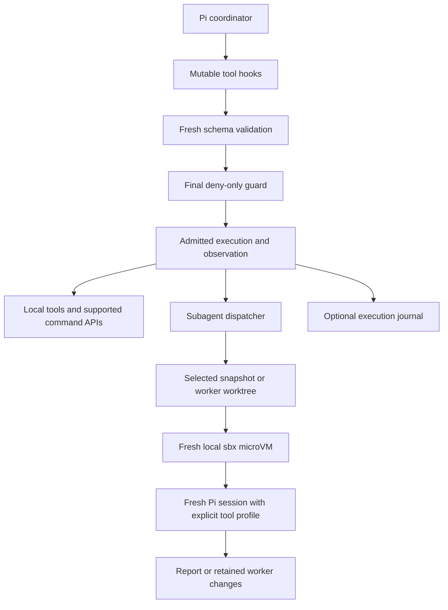

# Pi harness: research, design, and verification specification

## 1. Purpose and status

Improve coding accuracy and output quality while minimizing the total model usage
needed to obtain a correct result. Keep Pi as the coordinator and its core loop
small. Add replaceable capabilities through tools, extension events, explicit
configuration, and independently inspectable evidence.

Backdated commit metadata organizes this work by feature at the user's request;
it is not evidence of when research, implementation, or verification occurred.

This document records the mechanisms considered, the subset implemented, why each
boundary exists, observed verification, and remaining evaluation work. It is not a
claim that the combined harness outperforms stock Pi, Codex, or Claude Code.

**Implemented:** final execution policy, extension-owned cleanup, managed LSP
navigation, version-aware context retrieval, execution recording, revision-bound
verification, and sandboxed EGM/subagent delegation with optional worker worktrees.
Most examples remain opt-in. The development machine separately has EGM and the
sandbox delegation example activated through user-level Pi configuration.

**Not implemented:** a Docker Agent coordinator, Docker MCP tool integration,
Cordis dependency injection, an Investigation Gate, durable cross-session memory,
Obsidian integration, general multi-agent hypothesis orchestration, or a Harness²
experiment runner. Harbor was researched but not installed or configured here.

## 2. Research ledger

“Borrowed” below means a small mechanism was implemented in Pi. It does not mean
that the source framework was installed or that its complete architecture was
reproduced. Upstream documentation and interfaces can change.

| Source | Evidence and useful lesson | Decision for Pi |
| --- | --- | --- |
| [Pi extensions](extensions.md), [packages](packages.md), [skills](skills.md) | Executable extensions, lifecycle events, tools, and selectively loaded instructions support composition. Trusted extensions retain process permissions. | Preserve the coordinator and extension model; add only shared policy/lifecycle seams to core. |
| [Oh My Pi](https://github.com/can1357/oh-my-pi) | Richer agent-computer interfaces include LSP navigation and orchestration. A feature listing is not independent performance evidence. | Implement an opt-in managed LSP tool; do not copy OMP's entire runtime or claim its benchmark results. |
| [Aider repository map](https://aider.chat/docs/repomap.html) | Symbols, dependency relevance, and a token budget can select concise repository context. | Implement selected-file symbol summaries and source-version tracking. The result is not Aider's graph-ranked whole-repository map. |
| [Claude Code hooks](https://code.claude.com/docs/en/hooks) | Lifecycle interception provides enforceable control points, including pre-tool decisions. Hooks are not a sandbox. | Add a final deny-only execution guard after mutable hooks and fresh argument validation. |
| [Codex sandboxing](https://developers.openai.com/codex/sandboxing) | Execution restrictions and approvals are separate reliability controls. | Keep approval/policy distinct from OS isolation; use fresh worker environments and explicit verification. No claim of security equivalence. |
| [DeepSeek Harness](https://github.com/deepseek-ai/deepseek-harness), [Cordis primer](https://deepseek-harness.github.io/deepseek-harness/reference/cordis-primer), [Cordis](https://github.com/cordiverse/cordis) | The primer documents named services, declared dependencies, typed event dispatch, and reversible registrations with disposers. | Borrow owner-bound disposal and explicit interception boundaries. Do not introduce the Cordis framework, service container, or dependency graph into Pi. |
| [Docker Agent](https://github.com/docker/docker-agent) | A separate declarative agent runtime/coordinator can combine models, tools, and delegation. | Keep Pi as coordinator. A second agent runtime is unnecessary for the selected isolation slice. |
| [Docker MCP Toolkit](https://docs.docker.com/ai/mcp-catalog-and-toolkit/toolkit/) | MCP supplies external tool capabilities, including containerized tools; that does not isolate the caller's own process. | Defer tool integration. Do not describe MCP Gateway as agent-level sandboxing. |
| [Docker Sandboxes](https://docs.docker.com/ai/sandboxes/), [architecture](https://docs.docker.com/ai/sandboxes/architecture/), [credentials](https://docs.docker.com/ai/sandboxes/configuration/credentials/) | Local microVMs, explicit workspace sharing, network policy, and host-side credential injection provide an execution boundary. Local and cloud behavior differ. | Implement a local `sbx` backend with fresh guests and narrowly shared workspaces. Do not silently fall back to host execution. |
| [Harness²](https://github.com/google-research/harness2), [experiments](https://github.com/google-research/harness2/blob/main/docs/EXPERIMENTS.md) | Propose–Probe–Compose refinement and evidence-supported domain lessons make harness changes experimental rather than rhetorical. The release also documents unrestricted executor networking and disabled Codex sandboxing. | Adopt the measurement principle, not unrestricted execution or autonomous policy mutation. The refinement/evaluation loop is not implemented. |
| [Google Elephant-Goldfish Model](https://github.com/google/elephant-goldfish-model), [review skill](https://github.com/google/elephant-goldfish-model/blob/main/skills/egm-review/SKILL.md) | A context-rich author and fresh-context reviewers expose unstated assumptions. Reviews do not replace tests or human approval. | Install the complete skill package and delegate leaf reviewers to isolated Pi sessions. The parent performs synthesis when nested delegation is unavailable. |
| [Harbor agents](https://docs.harborframework.com/agents/pre-integrated-agents.md) | Current documentation lists Pi, Codex, and Claude Code integrations, with trajectory recording. | Prefer an existing evaluation runner over building one from scratch. A custom candidate setup must explicitly include these extensions and the `sbx` backend. |

SWE-agent, mini-SWE-agent, OpenHands, Cline/Roo, Goose, and Herder were also raised
as research candidates. Task-specific computer interfaces, reproducible execution,
human visibility, and replaceable adapters remain useful research questions.
There is no claim here of a source-complete internal audit or an integration with
those systems. Herder's exact project identity was not established; no repository
is inferred. Potential Obsidian memory is a custom requirement, not a borrowed
capability already present in this implementation.

## 3. Architectural boundaries



There are four independent boundaries:

1. **Context isolation:** a child receives the delegated task and selected files,
   not the parent's conversation. This reduces inherited assumptions; it does
   not itself restrict filesystem or process access.
2. **Policy enforcement:** supported execution APIs inspect final inputs before
   running. This is a control point inside a trusted process, not protection from
   arbitrary native code in a trusted extension.
3. **Execution isolation:** a local `sbx` guest limits access to host resources.
   Its own Docker daemon is not the host daemon. The host coordinator remains
   outside the guest and retains its normal permissions.
4. **Edit isolation:** a worker snapshot or Git worktree keeps changes away from
   the original checkout. Worktrees do not constitute a security sandbox.

## 4. Final execution policy and extension ownership

### Problem and decision

A check before mutable hooks can approve one command while a later hook executes
another. For example, an initially approved argv can be retained and changed while
a policy handler is awaiting. Resource cleanup implemented independently by every
extension can also leak listeners, ports, and subprocesses across reloads.

The agent loop now revalidates transformed arguments and isolates them before
execution. `beforeToolExecute` receives deeply frozen final input snapshots without
freezing the live agent context. Coding-agent extensions expose `execution_guard`
for model-dispatched tools, `pi.exec()`, and session Bash execution, including
custom Bash backends. The guard is deny-only: later handlers cannot undo a denial;
exceptions and malformed decisions fail closed. The checked command snapshot is
the one executed. Pre-aborted commands do not spawn.

`pi.registerCleanup()` associates acquired resources with their owning extension.
Callbacks run at most once, sequentially in reverse registration order; extension
scopes drain in reverse creation order. Async reload/shutdown await disposal, and
failed factories dispose only their own resources. Failures retain provenance and
do not skip other owners. Reentrant scope shutdown is rejected rather than
allowed to deadlock. Plain synchronous disposal initiates cleanup but does not
promise it has completed; callers needing that guarantee await runner disposal.

Core implementation: [agent loop](../../agent/src/agent-loop.ts),
[extension runner](../src/core/extensions/runner.ts),
[loader](../src/core/extensions/loader.ts),
[cleanup](../src/core/extensions/cleanup.ts), and [API documentation](extensions.md).
The public execution types and lifecycle wiring are committed together because
they share the runtime boundary and must remain internally consistent.

### Limits

Trusted extensions can still call native APIs or tool implementations directly.
Those operations are not intercepted merely because supported APIs have guards.
Separate workers do not automatically inherit parent guards. No default policy
blocks every dangerous command without an explicitly configured handler. Cleanup
cannot be guaranteed after forced process termination; a never-settling disposer
can delay awaited shutdown.

## 5. Code navigation and context engineering

### Managed code intelligence

`code_intelligence` provides definitions, references, hover, symbols, diagnostics,
and rename previews through explicitly configured stdio LSP servers. Requests are
serialized; opened disk documents are refreshed before queries and deleted files
are closed. Diagnostics require a fresh version-correlated response rather than
interpreting silence as a clean result. Rename edits are never applied, and
server-initiated workspace edits are rejected.

Servers start lazily and use owner-bound cleanup. Server configuration is trusted
executable authority: an LSP server still has Pi's OS permissions. Input positions
are 1-based UTF-16; returned LSP positions remain 0-based UTF-16. Request/initiation
deadlines, bounded output, and direct-child termination do not imply containment
of descendants or synchronization of unsaved editor buffers.

Implementation and configuration: [Code intelligence](../examples/extensions/code-intelligence/README.md).

### Version-aware context

`source_context` returns numbered source ranges plus full-file byte hashes. An
unchanged covering excerpt can be replaced with a short reference only while its
exact source output remains visible in the active context. Compacted-away text,
modified results, symbol summaries, and prior reference-only responses cannot
justify reuse. `force:true` always returns source. The ordinary `read` tool is
unchanged and does not silently count as context-engine evidence.

Before a model request, a late context hook rehashes visible source evidence and
warns when it is stale. Symbol mapping considers explicit candidate files with
bounded lexical ranking; it does not scan the whole repository or build a
persistent dependency graph.

Example: a source excerpt is read, then requested again unchanged. A short pointer
can replace duplicate model-facing text. If the file changes, or the original
excerpt leaves active context, that pointer is no longer sufficient and source
must be read again. This reduces payload in that case, not necessarily disk I/O
or end-to-end model tokens.

Limits include 8 MiB source files, 200 lines/24 KiB per source range, 128 tracked
files, 512 range proofs, and a selected-file map capped at 12 files/80 symbols.
A later arbitrary context transform or filesystem change can race the last
freshness check; this is not an edit authorization gate or filesystem lock.

Implementation and configuration: [Context Engine](../examples/extensions/context-engine/README.md).

## 6. Execution evidence and revision-bound verification

### Execution Recorder

The optional recorder consumes immutable `execution` observations with stable
execution IDs and `policy`, `start`, and `end` phases. A denied attempt has no
operation start/end. A start without an end is incomplete evidence, not success.
Tool observations describe raw results before model-visible `tool_result`
transformations; the normal transcript retains finalized results. Observer
failures do not replace the underlying operation result or error.

The journal stores local `execution-evidence` session entries and reconstructs
queries from the active branch. It does not merge abandoned-branch records into
the current view. `execution_log` lists, inspects, and exports dedicated JSONL
snapshots. Hashes/statuses/byte counts are the default, not duplicate raw inputs
and outputs. Optional input recording redacts common patterns, not every possible
secret. Digests are not encryption; transcripts and referenced artifacts can
independently expose sensitive data. This is not a tamper-proof audit service.

Implementation: [Execution Recorder](../examples/extensions/execution-recorder/README.md).

### Verification Engine

The `verify` tool runs explicitly configured executables through `pi.exec()`.
A successful result requires exit zero, no cancellation/kill, and identical
before/after manifests of declared input files. Evidence includes workspace,
configuration bytes, and sorted source hashes. A later failed, denied, or
cancelled attempt supersedes an older pass rather than reviving it.

Example: a check passes for `geometry.ts` and its declared fixtures. An external
edit changes the source. `verify status` reports the old pass as stale instead of
presenting it as proof for the new source. If source changes during the command,
the result is `changed_during_check`, not `passed`.

Checks cover explicit regular files, not implicit dependency trees: at most 256
files, 8 MiB each, 64 MiB total. Include check scripts, fixtures, lockfiles, and
relevant configuration in that scope. Unlisted files, installed tools, environment
variables, and remote state are not automatically fingerprinted. Stale-evidence
warnings neither run tests automatically nor prevent task completion. A hash-bound
pass is not a proof that the whole repository is correct.

Implementation: [Revision-bound verification](../examples/extensions/verification/README.md).

## 7. EGM delegation, sandbox lifecycle, and worktrees

EGM is a workflow/skill package, not a new AI model. The complete repository is
installed so skills can read reviewer personas and document standards. The tested
installation is pinned to `403d8881d62022490637d740657b33f01e321ea8`.

The optional subagent sandbox backend uses trusted user configuration or an
explicit CLI configuration path. Each call creates a uniquely named local guest
from a saved Pi template. The tested stack used `sbx 0.50.1`, a shell template
containing Pi `1.4.0`, and template `pi-delegation:1.4.0`. No cloud backend is selected.
CPU, memory, deadline, provider network hosts, and guest Pi executable are explicit.

Reviewer dispatch requires an explicit relative file list; `[]` permits a
concept-only brainstorm. Snapshot preparation rejects path escapes, Git metadata,
and symlinks. Reviewer source is a read-only **secondary** mount because the tested
sbx release rejects a read-only primary mount. Its mandatory writable primary is
empty disposable scratch. Reviewers receive only `read`, `grep`, `find`, and `ls`.
EGM personas cannot be elevated to worker permissions or shadowed by same-named
project definitions.

Children use fresh Pi state and disable automatic extensions, MCP, skills,
prompt templates, themes, and context-file discovery. Only the task, persona,
selected source, and EGM agents/resources are supplied. There is no parent-history
transfer or nested child delegation. The parent directly invokes leaf reviewers,
synthesizes findings, writes artifacts, and leaves design approval to the user.
Requests for nested EGM orchestrators fail with direct-dispatch guidance.

Workers can use writable current-source snapshots or native Git worktrees.
Worktrees get unique branches from **HEAD**, excluding the original checkout's
uncommitted changes. Worker paths and branches are retained for review, including
after failures; they are not automatically committed, merged, or deleted. Main Git
administration stays on the host. A delegated cwd must remain within the session
workspace or a worker workspace owned by the current extension runtime.

### Authentication and teardown

For Codex OAuth, a sandbox-scoped dynamic host command resolves the current access
token. The guest receives a synthetic non-secret OAuth token containing the account
identifier needed for Pi's local validation; the host proxy replaces outbound
Authorization. The real token and complete host auth file are not copied into the
guest. Resolver commands and their dependencies must live outside writable mounts.
Other providers require their own correctly configured proxy credentials.

The backend adds only scoped network allowances. These do not override a broader
base policy: use a reviewed deny-by-default sbx policy. The guest may have its own
Docker daemon, not the host socket. Trusted templates must not contain secrets or
history. A saved template and its user configuration are machine-local setup,
not reproducible merely by checking out this Git repository.

Cancellation, deadlines, reload, and shutdown stop/remove the guest and remove
scoped credentials, network rules, and payloads. Cleanup errors are failures,
not silent success. Malformed/incomplete JSON, provider failures, and token-length
termination do not count as completed reviews. A sandbox failure never triggers
host fallback. Local subprocess mode remains available only when sandbox mode has
not been selected; it must not be described as a security sandbox.

Implementation, installation, tool examples, and manual worktree maintenance:
[Subagent extension](../examples/extensions/subagent/README.md).

## 8. Fixes included with the features

The implementation includes corrections discovered during development:

- Revalidate hook-rewritten arguments and prevent retained references from changing
  the input after policy approval.
- Reject pre-aborted process launches, loading-time execution, and recursive guard
  execution instead of spawning outside the intended decision boundary.
- Make disposal idempotent, ordered, owner-scoped, and safe against reentry.
- Require actual active source visibility before reusing context; do not use file
  timestamps alone or treat missing diagnostics as a clean result.
- Keep observation failures separate from operation outcomes and keep evidence
  branch-local; newer verification failures supersede older successes.
- Replace the unsupported read-only primary sbx mount with disposable writable
  scratch plus read-only secondary source, and verify the real guest path.
- Fail on incomplete or token-truncated delegated responses and preserve explicit
  setup/cleanup errors instead of reporting review success or using a host fallback.

These fixes belong to their feature implementations. They do not establish that
all upstream harnesses shared the same bugs.

## 9. Observed verification and remaining risk

| Evidence | What it established | What it did not establish |
| --- | --- | --- |
| 45 agent-loop tests | Final policy ordering, rewritten-input validation, mutation isolation, and control-flow regressions passed. | An OS security boundary or every extension's compliance. |
| 104 coding-agent tests across eight focused files | Execution guard, cleanup, real TypeScript LSP, context freshness, evidence, verification, workspaces, and sandbox orchestration regressions passed. | Full-suite compatibility, complete adversarial isolation, or a task-success improvement. |
| Actual local sbx probes | Pi launches in a microVM; empty initial conversation; tested host paths unavailable; a different Docker daemon; unapproved network destination denied. | A complete security audit or proof against every guest/host escape. |
| Actual read-only secondary mount | A write attempt failed with `Read-only file system`. | Immutability of every file inside the guest. |
| Live EGM review using the configured Codex model | Reviewer read the supplied design and identified both seeded durability/idempotency defects. | General design-review recall, precision, or superiority to other harnesses. |
| Live implementation worker | Worker edited and verified its own worktree; the original dirty fixture remained unchanged and no automatic commit occurred. | Arbitrary task correctness or safety of every possible worker command. |
| Post-run resource inspection | Delegated guests and scoped secrets/rules were removed; the original trial remained stopped. | Guaranteed cleanup after forced host termination. |
| Installed Pi activation and browser smoke | Native Pi exposed the registered subagent tool; browser entry smoke passed. | Every interactive surface or provider configuration. |

Relevant regression files are `agent-loop.test.ts`, `execution-guard.test.ts`,
`extensions-cleanup.test.ts`, `code-intelligence.test.ts`, `context-engine.test.ts`,
`evidence-verification.test.ts`, `subagent-workspace.test.ts`,
`subagent-sandbox.test.ts`, and `subagent-egm.test.ts` in their respective package
test directories. Focused commands are in the feature READMEs.

`npm run check` reached TypeScript checking after formatting and repository
metadata checks, then failed on existing unrelated `packages/ai` provider/catalog
and obsolete-model-ID mismatches. An existing npm `min-release-age` configuration
warning was also observed. No successful full-repository check is claimed; those
unrelated files were not changed for this work. The user explicitly approved
committing with those failures documented, without bypassing Git hooks.

## 10. Problems encountered and their resolutions

These notes distinguish actual installation/runtime failures, failure cases
reproduced in regression tests, and deployment work that remains incomplete.
They are not a claim that each problem occurred in production.

### EGM installed in the wrong harness

**Problem:** installing EGM through OMP did not make it available in Pi. Its name
also suggested a downloadable model, but EGM is a skill/reviewer package using the
host's existing model.

**Resolution:** install the complete repository through Pi's package manager:

```text
pi install git:github.com/google/elephant-goldfish-model@403d8881d62022490637d740657b33f01e321ea8
pi list
```

The complete bundle preserves `agents/` and `resources/document_standards/`.
Pi runtime discovery verified all seven skill commands. Use `/skill:egm-review`,
not OMP/Claude-specific plugin commands. Skills alone did not supply a subagent
execution tool; the sandbox delegation extension supplies that capability.

### Committed extensions versus the installed Pi runtime

**Problem:** committing new core APIs did not upgrade the globally installed Pi.
Its extension declarations lacked `registerCleanup`, although new examples use it.
Installing those example files alone is not a complete runtime deployment.

**Resolution:** distinguish three states: code committed, extension configured,
and a compatible runtime actually executing it. `pi list` reports configured
packages, not proof that every dependency/API is available. User-level
`~/.pi/agent/settings.json` currently configures EGM and sandbox delegation;
LSP, Context Engine, Recorder, and Verification remain opt-in.

From the repository root, this source-checkout invocation was exercised:

```text
node --import ./packages/coding-agent/src/experimental/source-resolver.ts ./packages/coding-agent/src/cli.ts --offline --version
```

The repository's `pi-test.ps1` launcher uses the same resolver and source entry
point. Use a compatible source/runtime when enabling core-dependent examples,
with their documented `--extension` and configuration flags. A higher version
number on a different installed distribution does not prove it contains this
checkout's custom APIs.

**Status:** the source version command and SDK feature paths were verified, and
the installed Pi exposed the sandbox subagent tool. Replacing the everyday global
Pi command and activating every optional extension has not been completed. Do not
infer that deployment from the Git commits or from a successful `pi install`.

### Docker Desktop did not provide a usable `docker sandbox` command

**Problem:** `docker sandbox` reported that it had been removed. Docker Desktop
being running did not mean the separate Sandboxes CLI was installed, authenticated,
or serving its local daemon.

**Resolution:** install and use `sbx`. The tested Windows installation used:

```text
winget install --id Docker.sbx --exact --version 0.50.1
sbx diagnose
```

The attempted WinGet installation with explicit `--scope user` returned
`No applicable installer found`; omitting that flag succeeded with the tested
package. The executable was installed under
`%LOCALAPPDATA%/DockerSandboxes/bin/sbx.exe`; use its absolute path if an existing
terminal has not picked up PATH changes.

Diagnosis confirmed virtualization support, then reported a missing daemon and
separate sign-in requirement. Run `sbx daemon start` in a persistent terminal or
supervised service, complete `sbx login` in the browser, and use another terminal
for sandbox commands. A foreground daemon launched under a short command timeout
will not remain a dependable backend.

**Evidence:** the local daemon became healthy and actual local microVM creation
succeeded. No cloud backend or automatic Windows virtualization changes were used.

### Read-only primary workspace rejected by sbx

**Problem:** reviewer creation failed with
`primary workspace must be read/write (remove ':ro' or ':readonly')`.
Declaring the sole workspace read-only was incompatible with the tested release.

**Resolution:** make empty disposable scratch the writable primary and mount the
selected review snapshot as a read-only secondary workspace. Resolve that
secondary path through guest execution; do not silently review the empty scratch
directory if path mapping fails. Windows host paths and guest paths differ.

**Evidence:** actual mount inspection showed the selected source as read-only,
and a write attempt returned `Read-only file system`. The live reviewer then read
the selected document successfully. Regression tests cover secondary-path failure
and removal of temporary primary scratch.

### Guest payload ownership after `sbx cp`

**Problem:** copied probe files were root-owned; deleting one as the normal guest
agent failed with `Operation not permitted`. Restrictive copied payload permissions
can also prevent the agent from reading its task and synthetic authentication file.

**Resolution:** the coordinator repairs ownership inside the guest, then restricts
payload permissions before launching Pi as `agent`. Setup-only root execution is
inside the guest; it does not grant the model a host shell or mount the host home.
Remove only the payloads/sandboxes owned by the dispatch, not unrelated resources.

### OAuth-only Codex could not use an API-key placeholder as its login

**Problem:** the shell template supplied `proxy-managed` provider variables.
That is not a leaked real key, but `OPENAI_API_KEY` alone does not authenticate
Pi's OAuth-only `openai-codex` provider. Pi also validates the token's account claim
locally before issuing its request.

**Resolution:** use an explicitly configured host-side token resolver and matching
account identifier. Register it as a sandbox-scoped sbx secret, create only the
non-secret synthetic guest OAuth record, and let the host proxy replace the
outbound Authorization header. Do not copy the host auth file, print the access
token, import all environment secrets, or downgrade to another provider silently.

**Evidence:** the live EGM review and worker used the configured Codex model through
this path. Post-run inspection found no remaining scoped secrets or provider
allowances. Configure the resolver on each machine; it is intentionally absent
from committed credentials and templates.

### Truncated reports were incorrectly accepted as completed reviews

**Problem:** a regression fixture ending with `stopReason: \"length\"` and
`agent_end` resolved successfully even though its report was unfinished.

**Resolution:** reject token-length termination and other incomplete/failed
assistant endings rather than counting them as a completed review. Intermediate
tool-use messages are not final reports. Provider failures, malformed JSON, and
cleanup failures also remain errors.

**Evidence:** the new regression failed before the correction and passed with the
final focused suite. A failed reviewer did not establish that the design had no
findings; the parent must report its failure instead.

### Worktree did not include the original checkout's dirty changes

**Observation:** this is the selected contract, not a synchronization bug.
Worktrees start from HEAD so workers have a separate branch and edit area.

**Resolution:** choose snapshot mode when current uncommitted source is required.
Choose worktree mode when a clean committed starting point and retained branch are
desired. Inspect the returned worker path on the host; review before applying
changes. The extension does not commit or merge them automatically. Main repository
Git metadata is deliberately unavailable inside the worker.

**Evidence:** a live fixture kept its original dirty value unchanged while the
worker changed and verified a different value in its own worktree. The branch
still pointed to the original HEAD afterward.

### Source or verification evidence became stale

**Observation:** external edits and context compaction were exercised in tests.
A saved pass or a previous read is not automatically evidence for current bytes.

**Resolution:** reread source when its hash changes or its exact excerpt leaves
active context; use `force:true` when exact text is needed again. Rerun an
explicitly configured verification check after relevant source/config changes.
Do not suppress stale warnings, restore older successes after a newer failure,
or treat symbol summaries as inspected implementation.

### Full repository checks remain blocked by unrelated AI catalog errors

**Problem:** `npm run check` reported provider/catalog type mismatches and tests
referencing obsolete model IDs. It also emitted an existing `min-release-age`
configuration warning.

**Status:** unresolved by this harness work. The focused suites and browser smoke
passed, but they are not a replacement for a clean full-repository check. Those
unrelated AI/configuration files were left untouched, and the user explicitly
approved committing with the failures recorded. No Git hook was disabled or
bypassed. Fix the catalog/configuration mismatch as a separate change before
claiming that the full check is green.

## 11. Evaluation specification: is it fruitful?

Functional tests establish selected behavior, not improved coding performance.
The primary objective is correct task completion; token usage is optimized subject
to an acceptable correctness level, not by preferring cheap unsuccessful runs.

Use [Harbor](https://docs.harborframework.com/) as the proposed runner, with a small
Terminal-Bench subset and project-specific tasks. Start with five tasks to validate
grading/accounting, then expand to a representative ten-task set with repeated
runs and a held-out promotion set. Freeze repository state, instructions,
dependencies, permissions, budgets, and model/version where feasible.

Compare stock Pi, selected extension ablations, the combined candidate, Codex CLI,
and Claude Code. Distinguish same-model harness comparisons from product-level
model-plus-harness comparisons. If identical models/settings are unavailable,
report that confound rather than attributing the difference to the harness.

Record correctness from independent tests and requirements, blinded human review
where appropriate, regressions, interventions, time, and all model usage. Report
input/output/cache tokens separately and aggregate parent, child, retry, failure,
and verification-loop usage. Tokens per successful task must include the cost of
unsuccessful attempts. Different tokenizers and provider accounting prevent a
naive claim that raw cross-model token counts are equivalent; report monetary cost
and any missing/estimated usage alongside them.

A stock Harbor Pi adapter is not this candidate. Explicitly package/load the
extensions and trusted configuration, and integrate local sbx execution without
exposing host daemon sockets or credentials just to make nesting work. Keep the
verifier outside the agent's writable environment and control network access to
reduce answer leakage and verifier tampering. Sandbox overhead and model-token
cost should be reported separately.

No Harbor, Terminal-Bench, or controlled A/B performance experiment has been run
for this candidate. No reduction in end-to-end tokens, regression rate, or task
failure rate is claimed. Retain a mechanism because observed correctness or
quality-adjusted resource use improves, not because another harness advertises it.

## 12. Deferred work and explicit non-goals

- Investigation Gate: require task-appropriate reproduction/evidence before edits
  without blocking legitimate feature development.
- Docker MCP tools: select a useful real capability and enforce tool admission;
  this is separate from the now-working agent sandbox backend.
- Durable memory: explicit retrieval/consolidation of facts, failed approaches,
  decisions, and unresolved questions; no automatic Obsidian writes yet.
- Independent investigation orchestration: different hypotheses or responsibilities,
  not extra agents repeating the same work.
- Harness²-style experiments: evidence-based proposal selection and held-out
  evaluation, without autonomous weakening of safety policy.

Avoid an additional coordinator, a general DI framework, automatic merges,
unrestricted child context inheritance, and claims of benchmark superiority until
there is evidence that their added complexity or cost is justified.
